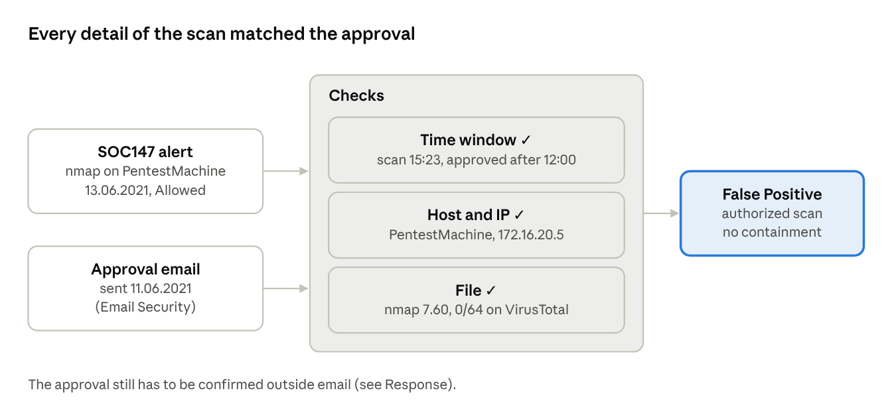
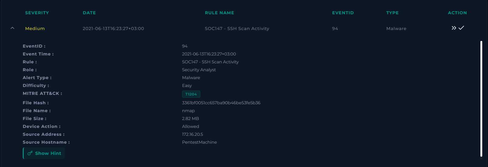
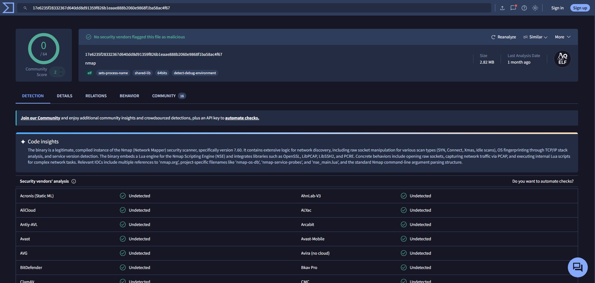
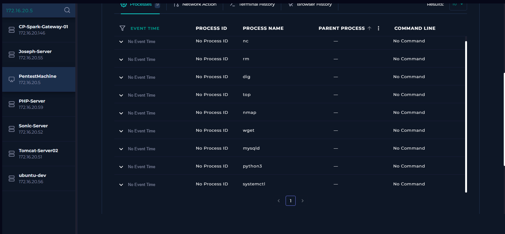
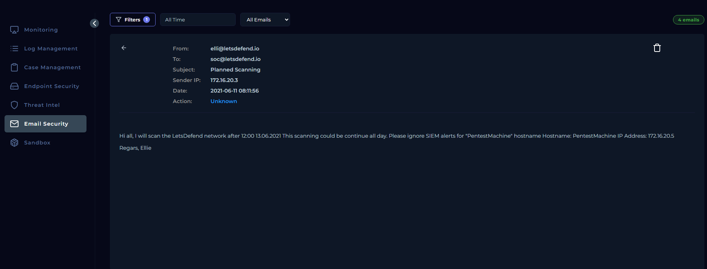
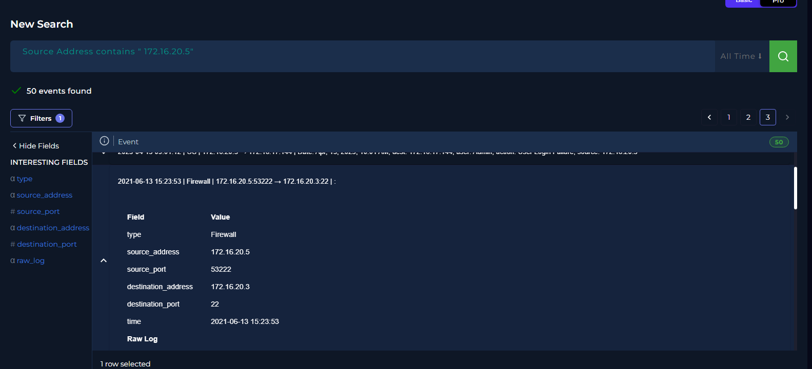
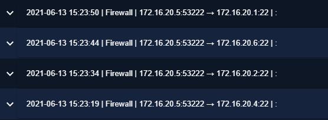

# SOC147 – Authorized SSH scan from PentestMachine (EventID 94)

Sep 29, 2026 · Bartek

**Scenario:** LetsDefend SOC lab (simulated environment). **Tools:** LetsDefend SIEM, Log Management, Endpoint Security, Email Security, VirusTotal.

**TL;DR:** False Positive. SOC147 flagged nmap on PentestMachine (172.16.20.5), and firewall logs show the host probing SSH (port 22) on five internal hosts. Two days earlier, a “Planned Scanning” email to the SOC announced a scan from exactly this host and IP on 13.06.2021 after 12:00, and the activity fits that window. The binary is the legitimate Nmap scanner (0/64 on VirusTotal). No containment is needed, but the approval should still be confirmed outside email, and the alert can be tuned with a time-boxed exception.

SOC147 on PentestMachine · alert and approval checked against each other

The scan time, host name and IP all match the approval email, and the file is the real Nmap. That is what makes this a False Positive, not the host name alone.

## Alert

SOC147 “SSH Scan Activity” (Medium, Malware) fired at 2021-06-13 16:23:27 (UTC+3) for nmap (2.82 MB) on host PentestMachine (172.16.20.5). Device action was **Allowed**. The rule maps the alert to MITRE T1204 (User Execution).

*Fig. 1 – SOC147 alert details: nmap on PentestMachine, device action Allowed*

## Triage

- Nmap is a dual-use tool: admins and pentesters use it, and so do attackers during reconnaissance. The file alone cannot decide the verdict; the context does.

- Questions to answer: is the binary really Nmap, what did the host scan, and was the scan approved (by whom, when, from which host)?

## Evidence

- **File:** the SHA256 (17e6235f…) has 0/64 detections on VirusTotal, and VirusTotal Code Insight identifies it as the legitimate Nmap 7.60 scanner. The size, 2.82 MB, matches the alert. See Fig. 2.

- **Endpoint:** Endpoint Security lists nmap among nine processes on PentestMachine, next to common admin and testing tools (nc, wget, python3, dig), without timestamps or command lines. See Fig. 3.

- **Approval:** on 2021-06-11, elli@letsdefend.io emailed soc@letsdefend.io (“Planned Scanning”) to announce a scan of the network after 12:00 on 13.06.2021 from PentestMachine (172.16.20.5), and asked the SOC to ignore SIEM alerts for that host. The email came from an internal IP (172.16.20.3). See Fig. 4.

- **Network:** on 2021-06-13 between 15:23:19 and 15:23:53, the firewall logged 172.16.20.5 connecting to port 22 on 172.16.20.1, .2, .3, .4 and .6, always from source port 53222. Five hosts in 34 seconds from one source port looks like an automated SSH sweep, not normal logins. See Fig. 5 and 6.

- **Match:** the scan time, host name and IP all match the approval.

*Fig. 2 – VirusTotal: 0/64 detections, identified as Nmap 7.60*

*Fig. 3 – Endpoint Security: processes on PentestMachine*

*Fig. 4 – Email Security: the “Planned Scanning” approval email*

*Fig. 5 – Log Management for 172.16.20.5: firewall event to 172.16.20.3:22*

*Fig. 6 – Firewall events on 2021-06-13: SSH connections to four more hosts*

## Timeline

| Time (as logged)             | Event                                                                                                 | Source         |
|------------------------------|-------------------------------------------------------------------------------------------------------|----------------|
| 2021-06-11 08:11:56          | “Planned Scanning” email to the SOC: scan from PentestMachine (172.16.20.5) after 12:00 on 13.06.2021 | Email Security |
| 2021-06-13 15:23:19–15:23:53 | 172.16.20.5 connects to port 22 on 172.16.20.4, .2, .6, .1 and .3 (source port 53222)                 | Firewall       |
| 2021-06-13 16:23:27          | SOC147 fires: nmap on PentestMachine, allowed                                                         | SIEM alert     |

## Verdict

**False Positive.** The tool is dual-use, but this activity was announced in advance and matches the approval in time, host and IP. The reviewed logs show scanning only.

## Response

**Decision:** no containment. Close as False Positive with the approval email attached as evidence.

**Recommended next steps**

- Confirm the approval outside email, for example with Ellie by phone or through a change ticket. An email asking the SOC to “ignore SIEM alerts” is also a classic social-engineering move.

- Ask for future pentest notices as change tickets with a clear scope: source host and IP, targets, time window and techniques.

## Detection tuning

The rule did its job: it caught a real scan. The goal is to cut noise from approved scans without hiding real reconnaissance.

- Add a time-boxed exception for SOC147 that requires both the IP (172.16.20.5) and the host name (PentestMachine), covers only the approved window, is linked to the approval and expires on its own.

- Never allow-list by host name alone: an attacker can rename a machine to “PentestMachine”.

- Keep alerting on scans from any other host, on this host outside the window, and on follow-up activity even inside the window (successful SSH logins, exploitation, large data transfers).

- The rule’s MITRE tag (T1204, User Execution) does not describe scanning. T1046 (Network Service Discovery) fits better and makes these alerts faster to triage.

## Artifacts

These are not IOCs, because the activity was authorized. They are listed for reference and for the tuning exception.

| Type              | Value                                                                  |
|-------------------|------------------------------------------------------------------------|
| MD5               | 3361bf0051cc657ba90b46be53fe5b36                                       |
| SHA256            | 17e6235f28332367d640dd8d91359f826b1eaae888b2060e9868f1ba58ac4f67       |
| Scanner host      | PentestMachine (172.16.20.5)                                           |
| Targets (port 22) | 172.16.20.1, .2, .3, .4, .6                                            |
| Approval email    | elli@letsdefend.io → soc@letsdefend.io, “Planned Scanning”, 2021-06-11 |

## MITRE ATT&CK (observed behavior)

| Technique                 | ID    | Evidence                                         |
|---------------------------|-------|--------------------------------------------------|
| Network Service Discovery | T1046 | SSH (port 22) probes to five hosts in 34 seconds |

## Open questions

- Log Management returns 50 events for 172.16.20.5 across all time. Anything outside the approved window (13.06.2021 from 12:00) is not covered by the approval and should be reviewed separately.

- When did the scan end? The email says it could run all day but gives no end time.
