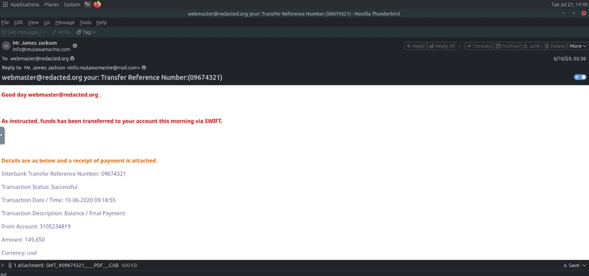
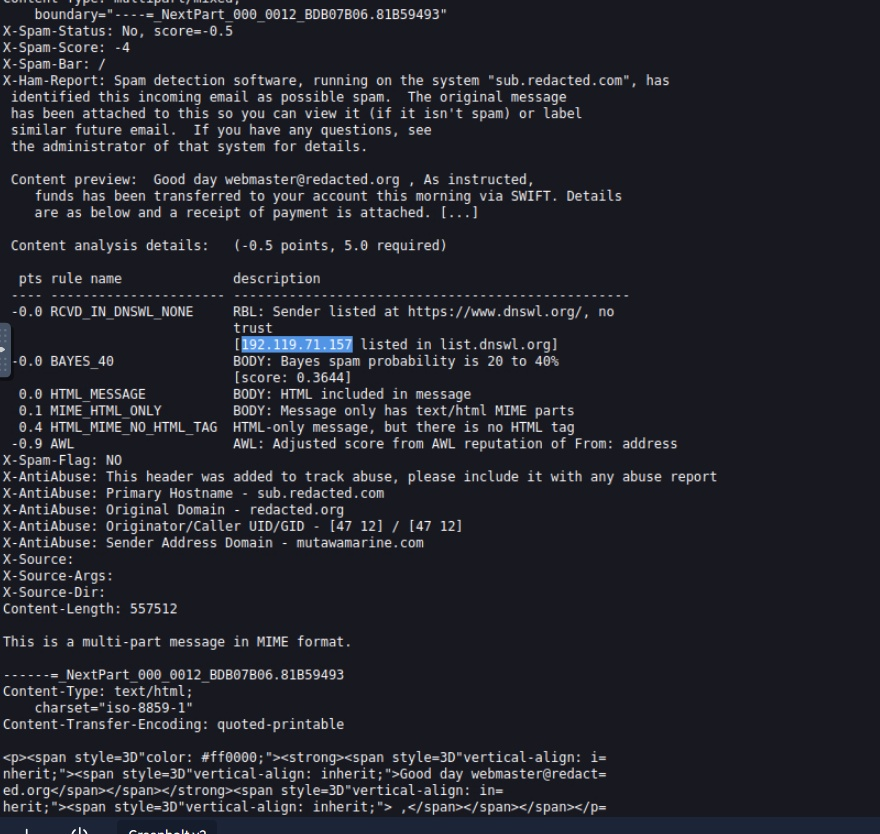
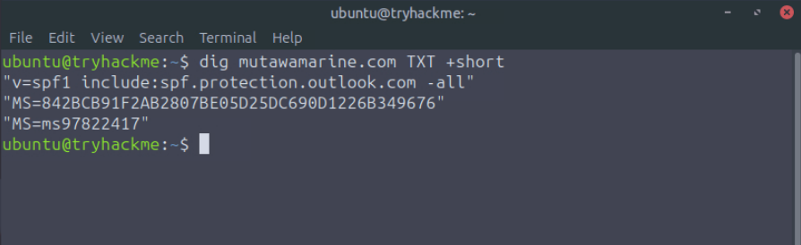
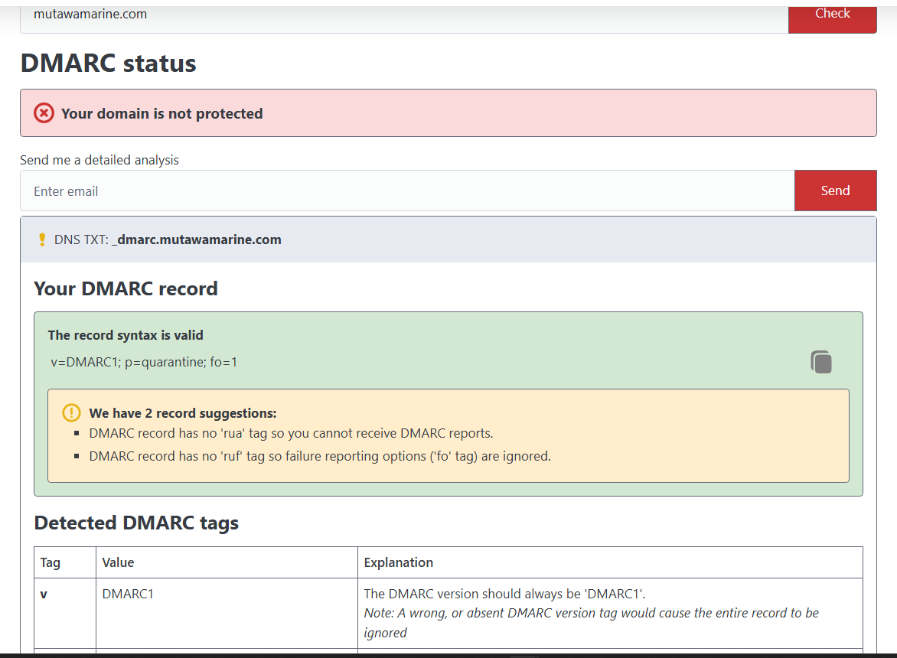
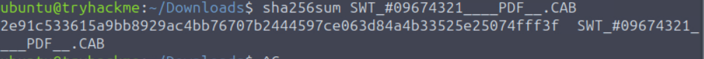
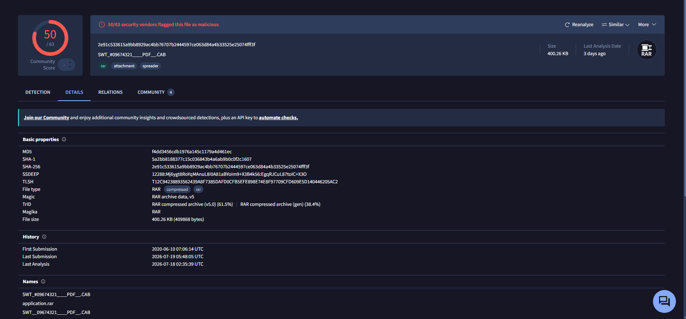

# Phishing Email Analysis: The Greenholt Phish (TryHackMe)

**Scenario:** TryHackMe – The Greenholt Phish (simulated environment). **Tools:** raw email headers, WHOIS, DNS lookups (SPF, DMARC), Linux terminal, VirusTotal.

**TL;DR:** True Positive. A phishing email posing as a known customer asked a Greenholt sales executive for a money transfer, and the user reported it. The Reply-To points to a different mailbox, and the email came from a HostPapa IP (192.119.71.157) that the Return-Path domain’s SPF record does not allow. The attachment is a RAR archive disguised as a .CAB file, flagged by 50/63 VirusTotal engines.

**Project Overview** A sales executive at Greenholt PLC reported a suspicious email supposedly coming from a known customer. The message contained several red flags, including a generic greeting, an unexpected request for a money transfer, and an unsolicited attachment. The incident was escalated to the SOC for analysis. My objective was to dissect the email artifacts, trace its true origin, and safely analyze the payload to determine the exact nature of the threat.

## 1. Email Header Analysis and Origin Tracing

To determine if the email was legitimate or spoofed, I began by extracting and analyzing the raw SMTP headers, bypassing the superficial information displayed by the email client.

*At first glance, the email appears legitimate, utilizing a convincing display name and subject line to trick the user.*

*However, analyzing the raw SMTP headers bypassed this superficial layer, revealing the true infrastructure used by the attacker.*

**Investigation Findings:** Initial inspection of the email revealed a transfer reference number in the subject line: **09674321**. While the sender's display name appeared as **Mr. James Jackson**, a deeper look into the headers exposed significant discrepancies:

- **Apparent Sender:** The email address in the From field was listed as info@mutawamarine.com.

- **True Destination:** The Reply-To header was set to a completely different, slightly altered address: info.mutawamarine@mail.com. This is a classic phishing technique designed to route the victim's response directly to the attacker's inbox.

Furthermore, by tracing the Received headers, I identified the true originating IP address of this email as **192.119.71.157**. A WHOIS lookup revealed that this IP is owned by **HostPapa**, a commercial hosting provider, which does not align with the legitimate corporate infrastructure of the supposed customer.

## 2. Domain Authentication Verification

To definitively prove the email was unauthorized, I conducted DNS lookups to check the sender domain's email authentication protocols.

**Investigation Findings:** Using command-line and web-based lookup tools, I queried the domain found in the Return-Path for its Sender Policy Framework (SPF) and Domain-based Message Authentication, Reporting, and Conformance (DMARC) records:

- **SPF Record:** v=spf1 include:spf.protection.outlook.com -all

- **DMARC Record:** v=DMARC1; p=quarantine; fo=1

The analysis of these records confirmed that the originating IP (owned by HostPapa) was not authorized to send emails on behalf of the domain, solidifying the conclusion that this was a domain spoofing attempt.

## 3. Malicious Payload Extraction and OSINT Analysis

The final phase involved investigating the unsolicited attachment safely within an isolated Linux virtual environment.

**Investigation Findings:** The email contained an attachment deceptively named **SWT\_#09674321\_\_\_PDF\_\_.CAB**. Instead of interacting with the file, I securely generated its cryptographic hash in the terminal to leverage Open-Source Intelligence (OSINT).

I obtained the SHA256 hash: 2e91c533615a9bb8929ac4bb76707b2444597ce063d84a4b33525e25074fff3f

Querying this hash against the VirusTotal database yielded critical insights:

- **Malicious Verdict:** The file was flagged as malicious by 50 out of 63 security vendors.

- **True File Type:** While the file name suggested a CAB or PDF file to trick the user, the magic bytes analysis confirmed the actual file type was a **RAR** compressed archive.

- **File Size:** 400.26 KB.

**Conclusion:** Based on the header discrepancies, failed domain authentication, and the identification of a malicious attachment disguised with a fake .CAB extension, I classified this incident as a phishing attempt aimed at getting a money transfer.

## IOCs

Defanged ([.]) to prevent accidental clicks.

| Type      | Value                                                        |
|---------------|------------------------------------------------------------------|
| Sender (From) | info@mutawamarine[.]com                                        |
| Reply-To      | info.mutawamarine@mail[.]com                                   |
| Origin IP     | 192.119.71[.]157 (HostPapa)                                    |
| Attachment    | SWT\_#09674321\_\_\_PDF\_\_.CAB (really a RAR archive)           |
| SHA256        | 2e91c533615a9bb8929ac4bb76707b2444597ce063d84a4b33525e25074fff3f |

## MITRE ATT&CK

| Technique                      | ID    | Evidence                                               |
|------------------------------------|-----------|------------------------------------------------------------|
| Impersonation                      | T1656     | Poses as a known customer (display name Mr. James Jackson) |
| Phishing: Spearphishing Attachment | T1566.001 | Email with a malicious attachment                          |
| Masquerading: Masquerade File Type | T1036.008 | RAR archive named .CAB, with “PDF” in the name             |

## Recommendations

- Block the sender addresses, the origin IP and the attachment hash.

- Search other mailboxes for the same sender, subject or hash, and remove any matches.

- Remind staff to confirm payment requests through a known phone number.

## Open questions

- Did anyone else receive or reply to this email?

- What is inside the RAR archive? It was not unpacked in this analysis.
